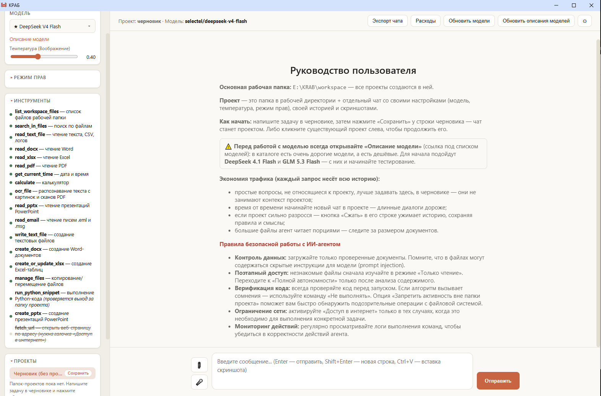

# КРАБ — Компьютерный Рабочий Агент Без установки

Локальный ИИ-агент для работы с документами на Windows. Портативная, без установки: распакуйте папку,
запустите — работает. Не требует прав администратора, установки Python и чего-либо ещё; работает за корпоративным прокси.

Модели — через [ИИ-роутер Selectel](https://selectel.ru/?ref_code=1590b2d62c): один ключ даёт доступ
к сотням моделей (DeepSeek, Qwen, GPT, Claude, Gemini и другие) с оплатой в рублях по факту использования и без политического шаманизма.

> КРАБ — неофициальный клиент. Selectel не имеет отношения к этой программе. 

<p align="center">
  
</p>

## Что умеет

- **Читает** Word, Excel (включая старый .xls), PDF, PowerPoint, письма .eml и .msg, текстовые файлы и CSV; ищет по содержимому всех файлов папки.
- **Распознаёт текст** на картинках и сканах PDF (Tesseract OCR, русский и английский — в комплекте).
- **Видит скриншоты**: вставьте картинку через Ctrl+V — модели с поддержкой изображений получат её напрямую.
- **Создаёт** отчёты Word, таблицы Excel, презентации PowerPoint, текстовые файлы; выполняет Python-код для расчётов, графиков и пакетной обработки (режим «Полная автономность»).
- **Генерирует изображения** моделями из каталога.
- **Проекты**: у каждого своя папка с документами, перепиской и настройками; история сжимается в сводку, когда разрастается.
- **Учёт расходов** по дням, месяцам и проектам; дневной лимит в рублях.
- Открытие веб-страниц по адресу (отдельная галочка), голосовой ввод (если поддерживает браузер), экспорт чата в Markdown.

Два режима прав: **«Только чтение»** — агент только читает и анализирует; **«Полная автономность»** — создаёт файлы и выполняет код. Режим, модель, температура и галочки «Режима прав» (доступ в интернет, авто-выполнение кода) — свои у каждого проекта и запоминаются отдельно.

## "Установка" и настройка

1. Скачайте архив `KRAB-x.y.z-windows-x64.zip` из [Releases](../../releases) и распакуйте в любую папку, например `C:\KRAB`.
2. Запустите файл **Запуск.bat** в папке программы. Первый запуск займёт около минуты — программа
   подготовит папку к работе: снимет с файлов пометку «загружено из интернета» (после этого Windows
   не задаёт вопросов о запуске) и создаст ярлыки «КРАБ - Запуск» и «КРАБ - Стоп» в папке, ярлык «КРАБ»
   на рабочем столе. Дальше запускайте ярлыками — мгновенно.
3. Получите ключ API: [зарегистрируйтесь в Selectel](https://selectel.ru/?ref_code=1590b2d62c) → **Продукты → ИИ-роутер → Создать** → сгенерируйте ключ → пополните баланс (чтобы создать ИИ-роутер, нужно обязательно пополнить на 200р - они же и уйдут на токены).
4. В программе нажмите шестерёнку, вставьте ключ, «Сохранить и перезапустить».

Подробная инструкция с настройкой прокси — в файле `ИНСТРУКЦИЯ.html` внутри папки.

**Требования:** Windows 10/11 64-бит, любой браузер (в Chrome, Edge, Яндекс.Браузере открывается отдельным окном без вкладок). Интернет нужен только для обращения к моделям.

**Остановка:** закройте окно программы — сервер остановится сам. Ярлык «КРАБ - Стоп» делает то же принудительно.

**Удаление:** удалите папку и ярлык с рабочего стола. В системе ничего не остаётся.

## Обновление программы

- КРАБ проверяет обновления один раз при запуске: если вышла новая версия, окно предложит скачать и применить её само. Клик по строке версии внизу слева — проверка вручную.
- При обновлении заменяется только код программы, она перезапускается сама. Настройки, проекты и история не трогаются.
- Если в новой версии обновлены встроенные инструменты (Python, Tesseract OCR), программа сообщит об этом и откроет страницу релиза: скачайте полный архив `KRAB-x.y.z-windows-x64.zip` и обновите им папку программы (папку `workspace` и файл `bin\.env` не трогайте).

## Безопасность — прочитайте

Что в программе защищает:

- **Файловые инструменты жёстко ограничены рабочей папкой.** Чтение, поиск, создание и перемещение файлов работают только внутри `workspace\` (для проекта — внутри его папки): каждый путь сервер заново проверяет и выходы за пределы, включая обход через `..\..`, отклоняет.
- **Права проверяет сервер, а не модель.** В режиме «Только чтение» создающие инструменты недоступны, даже если модель попытается их вызвать под другим предлогом.
- **Код агента выполняется в песочнице.** Файловые операции исполняемого кода ограничены рабочей папкой проекта (обход через `..`, симлинки и сетевые пути блокируется), запуск программ, сетевые соединения и загрузка системных библиотек из кода запрещены, а секреты (ключ API, пароль прокси) коду не передаются. Перед запуском код дополнительно сканируется: строки с выходом за папку (буквы дисков, `..`, сетевые пути) подсвечиваются в чате.
- **Каждый запуск кода можно сделать ручным.** Выключите «Выполнять код автоматически» — модель сможет только предлагать код, а запускаться он будет по кнопке «Выполнить», каждый раз.
- **Интернет — только по отдельной галочке.** Без «Доступа в интернет» агент не открывает веб-страницы вовсе.
- **Ключ API и пароль прокси** хранятся зашифрованными под вашим пользователем Windows (DPAPI) в `bin\.env`.
- Все данные остаются на вашем компьютере; наружу уходят только запросы к API Selectel (через ваш прокси, если он задан).

Чего защита не делает (честно):

- **Песочница программная, а не системная.** Код исполняется отдельным процессом Python под надзором встроенного сторожа (перехват файловых операций, сети, запуска программ) — это надёжно закрывает обычные каналы, но не абсолютную изоляцию на уровне ОС (Job Object, контейнер). Теоретически замаскированный код может попытаться обойти перехват — для критичных задач включайте ручное подтверждение кода.
- **В документах могут быть скрытые указания для модели.** Агент предупреждён об этом, но гарантий нет. Непроверенные документы — в режиме «Только чтение», без доступа в интернет.
- **Интерфейс — локальный, без пароля.** Он и не нужен: по умолчанию КРАБ доступен только с этого компьютера (`127.0.0.1`) и никого чужого не видит. Но не открывайте его в общую сеть (`HOST=0.0.0.0`) — тогда любой в этой сети сможет читать файлы рабочей папки и выполнять код.

Включайте «Полная автономность» только для задач и документов, которым доверяете.

Windows SmartScreen или антивирус могут предупредить о скриптах запуска (`.bat`, `.vbs`, `.ps1`) — это штатные файлы программы, их код открыт в этом репозитории.

## Структура папки

```
KRAB\
├─ Запуск.bat            запуск (первый запуск; дальше — ярлыки)
├─ КРАБ - Запуск.lnk     ярлыки со значком краба — создаёт программа при первом запуске
├─ КРАБ - Стоп.lnk
├─ ИНСТРУКЦИЯ.html       инструкция
├─ workspace\            рабочая папка: каждая подпапка — проект, .draft — черновик (очищается при закрытии)
└─ bin\                  программа: код, переносимый Python, Tesseract, настройки (.env), журналы (logs)
```

## Партнёрская ссылка

Ссылки на Selectel в программе и в этом файле — партнёрские. Если вы зарегистрируетесь по ним, автор
получит вознаграждение от Selectel; для вас условия не меняются. Так вы поддержите развитие КРАБа.
Можно зарегистрироваться и без ссылки — программа будет работать так же.

## Для разработчиков

В репозитории только исходники py, index.html, скрипты запуска, инструкция.
Переносимый Python с библиотеками и Tesseract OCR в репозиторий не входят — они собираются в архив релиза.

Запуск из исходников на любой ОС с Python 3.11+:

```
pip install -r bin/requirements.txt
cd bin && python -m uvicorn app:app --host 127.0.0.1 --port 38573
```

Стек: FastAPI + uvicorn, OpenAI-совместимый клиент, интерфейс — один HTML-файл без сборки.

## Лицензии

Код КРАБа — [MIT](LICENSE). В архив релиза входят сторонние компоненты со своими лицензиями:
Python (PSF), Tesseract OCR и языковые данные (Apache 2.0), библиотеки Python — см. `THIRD-PARTY-NOTICES.md`.
